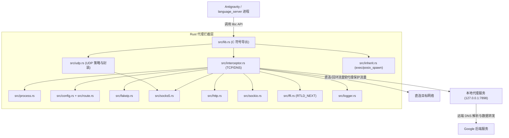

# Antigravity-Proxy Linux (Rust 重构版) 项目结构与设计说明

本文档详细阐述本项目的目录结构、各组件职责、Rust 内部模块架构、部署脚本工作流程以及网络拦截机制。

---

## 一、完整项目目录树

```text
antigravity-proxy/
├── Cargo.toml                    # Rust 项目配置与元数据 (定义 cdylib 动态库构建)
├── Cargo.lock                    # Rust 依赖版本锁定文件
├── .cargo/
│   └── config.toml               # Cargo 交叉编译目标链接器配置
├── config.json                   # 核心代理与路由分流配置文件 (默认端口 7898)
├── config-web.html               # 跨平台可视化 Web 配置编辑器
│
├── bin/                          # 运行时目录
│   ├── x64/
│   │   └── libantigravity_proxy.so   # Linux x86_64
│   ├── arm64/
│   │   └── libantigravity_proxy.so   # Linux AArch64
│   ├── windows-x64/
│   │   ├── version.dll               # 放到 Antigravity.exe 旁边（日常部署）
│   │   ├── config.json               # 与 version.dll 一起复制
│   │   └── antigravity-proxy.exe     # 可选启动器，目标不加载 version.dll 时再用
│   ├── macos-arm64/              # dylib 由 macOS CI 上传，仓库里先放 config.json
│   │   └── config.json
│   └── macos-x64/
│       └── config.json
├── crates/
│   ├── agy-core/                 # 配置、FakeIP、路由、SOCKS/HTTP 组包
│   ├── windows-proxy/            # version.dll（仅 Windows 目标含挂钩实现）
│   ├── windows-injector/         # 可选的 antigravity-proxy.exe
│   └── macos-proxy/              # libantigravity_proxy.dylib（DYLD_INSERT_LIBRARIES）
│
├── scripts/                      # 辅助与跨平台构建脚本
│   ├── zig-ld.py                 # Linker 包装器 (过滤不支持的参数并调用 zig cc)
│   ├── zig-ld-x64.cmd            # Windows 下 x64 交叉编译调用脚本
│   └── zig-ld-arm64.cmd          # Windows 下 ARM64 交叉编译调用脚本
│
├── src/                          # [Rust 2021] 核心拦截层源代码
│   ├── lib.rs                    # 库入口、.init_array 构造器、C ABI 导出
│   ├── interceptor.rs            # TCP/DNS 决策：FakeIP、路由、IPv6、握手
│   ├── endpoint.rs               # sockaddr → 域名/IP/端口（含 v4-mapped 与 FakeIP）
│   ├── route.rs                  # 路由规则编译与 UDP 策略判定
│   ├── fakeip.rs                 # 环形 FakeIP 池（回绕时回收双向映射）
│   ├── socks5.rs                 # SOCKS5 CONNECT 与 UDP Associate
│   ├── http.rs                   # HTTP CONNECT
│   ├── udp.rs                    # UDP 阻断 / 直连 / SOCKS5 封装
│   ├── sockio.rs                 # poll 超时、非阻塞 connect、代理地址构造
│   ├── inherit.rs                # child_injection=false 时清理 LD_PRELOAD
│   ├── guard.rs                  # 线程内重入保护，内部调用走真实 libc
│   ├── process.rs                # 进程名与 target/exclude 匹配
│   ├── config.rs                 # 配置加载、规则编译
│   ├── logger.rs                 # 日志路径、启动时轮转
│   └── ffi.rs                    # dlsym(RTLD_NEXT) 真实符号
│
├── src_c/                        # [历史归档] 原 C 语言参考实现源码
│   ├── main.c / config.c / fakeip.c / socks5.c / http.c / logger.c / cJSON.c
│   └── *.h 头文件
│
├── antigravity-proxy.sh          # Linux 启动器（默认脱离终端）
├── antigravity-proxy-macos.sh    # macOS 启动器（DYLD_INSERT_LIBRARIES，不使用 open -a）
├── install.sh                    # 一键安装与系统集成脚本 (支持桌面快捷方式修补)
├── uninstall.sh                  # 还原与干净卸载脚本
├── build.sh                      # Linux / 交叉编译入口 (native、arm64、windows、all)
├── build.ps1                     # Windows 上编译 Linux .so 与 Windows 运行时
├── Makefile                      # 标准 Makefile 构建规则
├── README.md                     # 项目概述与快速指南
├── 使用说明_Linux.md              # 详细用户使用手册与排障指南
└── 项目结构与设计说明.md          # [本文档] 完整架构与设计原理剖析
```

---

## 二、部署与管理脚本详解

### 1. `install.sh` (一键安装助手)
负责将代理环境部署到目标系统中，提供两种模式：

1. **用户全局/桌面集成模式 (`bash install.sh`)**：
   - 读取 `uname -m` 判断系统属于 `x86_64` 还是 `aarch64`。
   - 将对应架构的 `libantigravity_proxy.so` 部署至 `~/.local/lib/antigravity-proxy/`。
   - 生成用户配置至 `~/.config/antigravity-proxy/config.json`（若已有配置则保留）。
   - 在 `~/.local/bin/antigravity-proxy` 部署全局快捷命令。
   - **修补 `.desktop` 文件**：自动扫描 `/usr/share/applications/` 与 `~/.local/share/applications/` 中的 `antigravity.desktop`，将原执行命令备份为 `.bak`，并将 `Exec=` 行包装为代理启动命令。实现**点击桌面图标自动走代理**。

2. **独立目录便携模式 (`bash install.sh <目录路径>`)**：
   - 针对解压便携版 Antigravity，将 `.so` 库、`config.json` 与启动器拷入目标目录。
   - 自动在目标目录生成 `start-with-proxy.sh` 脚本，开箱即用。

### 2. `antigravity-proxy.sh` (智能启动与环境诊断器)
- **自适应架构选择**：无论在 Intel PC、树莓派还是 ARM 云服务器，自动根据当前架构加载对应的 `libantigravity_proxy.so`。
- **动态链接器劫持**：通过 `export LD_PRELOAD="libantigravity_proxy.so"` 实现无侵入挂钩。
- **子进程天然继承**：Linux 进程在派生（`fork` / `exec`）子进程时自动继承环境变量，使 Antigravity 主程序唤起的 `language_server`、`node` 自动受到代理保护。
- **环境自检 (`--test`)**：内置测试代码，验证当前环境下 FakeIP 解析及动态库拦截是否正常工作。`--test` 与 `--foreground` 都留在前台。
- **默认脱离终端**：普通启动用 `setsid`/`nohup` 把目标放到新会话并立刻返回，关闭终端不会结束 Antigravity。`install.sh` 生成的 `start-with-proxy.sh` 调用同一入口。

### 3. `uninstall.sh` (干净卸载还原)
- 恢复备份的 `antigravity.desktop.bak` 为原始桌面启动项。
- 移除 `~/.local/lib/antigravity-proxy` 与快捷指令。
- 提示用户是否保留个性化配置文件目录。

---

## 三、Rust 内部模块架构



### 关键模块职责：
1. **`lib.rs`**：`.init_array` 里完成配置和日志初始化，并导出 glibc 同名符号。内部系统调用一律通过 `ffi.rs` 的 `dlsym(RTLD_NEXT)`，避免和本库导出的符号递归。
2. **`fakeip.rs`**：`RwLock` 保护的环形地址池。游标跳过网络地址和广播地址；地址被重新分配时，旧域名会从正向表和反向表里一起删掉。`/31`、`/32` 这类过小的前缀会拒绝分配并回退到系统解析。映射是**每个进程一份**，不使用跨进程共享内存。
3. **`interceptor.rs`**：
   - 回环、代理自身地址直连。Unix 套接字不拦截。
   - 纯 IPv6 先看 `ipv6_mode`（`proxy` / `direct` / `block`）。IPv4-mapped IPv6 按 IPv4 处理，因此 FakeIP 的 `::ffff:198.18.x.x` 仍能还原域名。
   - `routing.rules` 命中 `direct`，或 `default_action=direct` 时直连。若当时手里只有 FakeIP，会用系统解析器重新解析域名再连接。
   - 端口 53 在 `dns_mode=direct` 时直连。不在 `allowed_ports` 里的端口直连（空列表表示所有端口）。
   - 代理 TCP 连接使用 `poll` 等待 `EINPROGRESS`，握手也用 `poll`。不清除 `O_NONBLOCK`，不改写应用原来的 `SO_RCVTIMEO` / `SO_SNDTIMEO`。握手成功后 `connect` 返回 0。
   - IPv6 套接字访问 IPv4 代理时，会暂时关闭 `IPV6_V6ONLY` 并连接 `::ffff:` 形式的代理地址。
4. **`route.rs`**：编译域名通配（`*` / `?` 以及前导点后缀）、CIDR、端口范围和协议。`use_default_private=true` 且路由开启时，会在规则前插入 `default-private`（`10/8`、`172.16/12`、`192.168/16`、`127/8`、`169.254/16`、`fc00::/7`、`fe80::/10`、`::1/128`），对 TCP 和 UDP 都直连。`priority_mode=order` 时这条规则排在最前；`number` 时数值更大的用户规则可以盖过它。路由关闭时，仍按 `use_default_private` 做局域网直连，以保持原 Linux 配置的含义。
5. **`udp.rs`**：`udp_mode=direct` 不改 UDP；`block` 对非回环、非 53 端口返回 `EACCES`；`auto` 在 SOCKS5 下做 UDP Associate，其它代理类型按 `udp_fallback`。Associate 失败时同样看 `udp_fallback`。封装覆盖 `send` / `sendto` / `sendmsg` / `sendmmsg` 和对应的接收、`close`（关闭控制连接）。
6. **`inherit.rs`**：`child_injection=true` 时保持 `LD_PRELOAD`，子进程加载本库后自己过滤。`child_injection=false` 时从 `execve` / `execv` / `execvp` / `execvpe` / `fexecve` / `posix_spawn` / `posix_spawnp` 的环境里去掉 `libantigravity_proxy.so`。
7. **`process.rs`**：读取 `program_invocation_short_name`、`/proc/self/exe` 和 `cmdline`。`ANTIGRAVITY_PROXY_FORCE` 可强制视为目标进程。

### 和参考实现的有意差异
- Linux 拦截层不做 Windows DLL 代理。Windows 运行时在 `crates/windows-proxy`（导入表挂钩，不是 MinHook），见下文。
- 不做 `diagnostics.agent_ip_probe` 的外部 IP 探测，避免额外出网。
- FakeIP 没有跨进程共享映射。每个进程自己解析自己的域名。
- 代理认证（SOCKS5 用户名/密码、HTTP `Proxy-Authorization`）未实现；参考实现同样只使用无认证。
- 命中 FakeIP 网段但找不到域名时直接失败，不把 `198.18.0.0/15` 当作真实目标交给代理。
- `ipv6_mode=block` 会阻断纯 IPv6 UDP，而不是在 UDP Associate 判定失败后改成直连。
- `traffic_logging` 会被解析，但不会额外记录每个数据包。

---

## 四、构建体系说明

三份产物都可以从这份 Cargo workspace 编出来。

1. **Linux 本机**（`build.sh` 或 `make`）：`cargo build --release -p antigravity-proxy`，按 `uname -m` 复制到 `bin/x64` 或 `bin/arm64`。
2. **Linux arm64 交叉编译**：安装 `gcc-aarch64-linux-gnu` 后执行 `make arm64` 或 `./build.sh arm64`。链接器在 `.cargo/config.toml` 里指向 `aarch64-linux-gnu-gcc`。
3. **在 Windows 上编 Linux .so**：`build.ps1` 仍用 `scripts/zig-ld.py` 驱动 `zig cc`，目标 `x86_64-unknown-linux-gnu` 与 `aarch64-unknown-linux-gnu`。
4. **Windows x64 运行时**：
   - 在 Linux 上安装 `gcc-mingw-w64-x86-64` 后：`./build.sh windows` 或 `make windows`，目标 `x86_64-pc-windows-gnu`。
   - 在 Windows 上：`build.ps1 -Target windows`，优先 `x86_64-pc-windows-msvc`，否则 GNU 目标。
   - 输出 `bin/windows-x64/version.dll`（日常部署就复制它和 `config.json`）。同目录的 `antigravity-proxy.exe` 是可选启动器，不是安装步骤。

5. **macOS dylib**：在 Mac 上 `./build.sh macos` 或 `make macos`。Linux 没有 Apple SDK，不从这里交叉编译。GitHub Actions `macos-latest` 编 `aarch64-apple-darwin` 与 `x86_64-apple-darwin`，并对 arm64 跑 `scripts/smoke-macos.sh`（无签名小程序上的 FakeIP，不启动 Antigravity）。
6. **验证**：`cargo test`，然后 `bash scripts/smoke.sh target/release/libantigravity_proxy.so`。`src_c/` 是早期 C 草稿，当前构建不编译它。从 Windows 交叉编译 Linux `.so` 时，由 `build.ps1` 设置 zig 的 `RUSTFLAGS`，不写进 `.cargo/config.toml`。

`./build.sh all` 在 Linux 上编当前架构、arm64 与 Windows，并打印 macOS 需要在 Mac 或 Actions 上编。

CI：`.github/workflows/ci.yml` 跑 Linux 单测、release 和 `scripts/smoke.sh`。`.github/workflows/build.yml` 额外交叉编译 Linux arm64、Windows x64，并在 macOS runner 上编 dylib。没有在真实 Antigravity 进程里做过插入验证。

## 五、Windows 运行时

部署只复制 `version.dll` 和 `config.json` 到 `Antigravity.exe` 同目录，然后照常启动。`antigravity-proxy.exe` 不参与这一步；它只在目标不会加载 `version.dll` 时，用来挂起创建并注入。

`version.dll` 在加载时：

1. 从 DLL 目录、`ANTIGRAVITY_PROXY_CONFIG`、当前目录、`%APPDATA%\antigravity-proxy\config.json` 读取与 Linux 相同的 JSON。
2. 用 `GetProcAddress` 记下 Winsock / `CreateProcess` 的原始地址，再改写其他模块导入表里的对应槽位，并挂钩后续的 `GetProcAddress` 与 `LoadLibrary*`。
3. 当前进程名不在目标列表里时，只安装进程创建钩子，避免无关进程被重定向。
4. `CreateProcessA/W` 给子进程加上 `CREATE_SUSPENDED`，注入这枚 DLL，再按原调用决定是否恢复。

Windows 的 FakeIP / 路由 / 握手字节在 `crates/agy-core`。Linux 拦截层仍用 `src/` 里随 #1 落地的实现（环形回收、非阻塞 connect、UDP Associate），两边不共用同一套源文件，以免把 Linux 行为绑死在 Windows 钩子上。

许可：仓库保持 MIT。没有厂商化 MinHook（BSD-2-Clause）或参考仓库的 C/C++ 源码。Windows API 的导出名（`GetFileVersionInfo*` 等）是系统接口，转发到 `System32\version.dll`。

## 六、macOS 运行时

`crates/macos-proxy` 编出 `libantigravity_proxy.dylib`。dyld 通过 `__DATA,__interpose` 挂钩 BSD socket，而不是替换系统库文件。插入库里对 `connect` / `getaddrinfo` 等的直接调用仍进 libSystem：dyld 不改写插入库自己的绑定，而 `dlsym` 可能把钩子指回自己。启动器用 `DYLD_INSERT_LIBRARIES` 直接执行 `.app/Contents/MacOS/` 里的可执行文件。

SIP 与 Hardened Runtime 会忽略这个环境变量。细节、重签名 entitlement 和尚未实现的 UDP Associate 写在 `使用说明_macOS.md`。CI 的 macOS 自检只覆盖无签名测试程序的 FakeIP。
