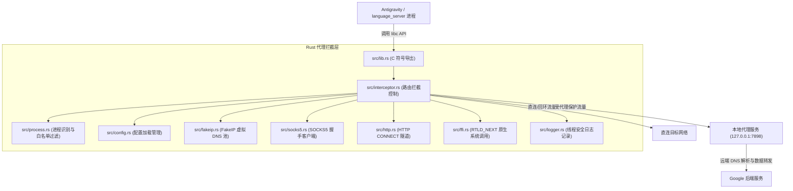

# Antigravity-Proxy Linux (Rust 重构版) 项目结构与设计说明

本文档详细阐述本项目的目录结构、各组件职责、Rust 内部模块架构、部署脚本工作流程以及网络拦截机制。

---

## 一、完整项目目录树

```text
antigravity-proxy/
├── Cargo.toml                    # Rust 项目配置与元数据 (定义 cdylib 动态库构建)
├── Cargo.lock                    # Rust 依赖版本锁定文件
├── .cargo/
│   └── config.toml               # Cargo 交叉编译目标链接器配置
├── config.json                   # 核心代理与路由分流配置文件 (默认端口 7898)
├── config-web.html               # 跨平台可视化 Web 配置编辑器
│
├── bin/                          # [预编译就绪] 目标动态链接库输出目录
│   ├── x64/
│   │   └── libantigravity_proxy.so   # Linux x86_64 (AMD64) 专用劫持库
│   └── arm64/
│       └── libantigravity_proxy.so   # Linux AArch64 (ARM64) 专用劫持库
│
├── scripts/                      # 辅助与跨平台构建脚本
│   ├── zig-ld.py                 # Linker 包装器 (过滤不支持的参数并调用 zig cc)
│   ├── zig-ld-x64.cmd            # Windows 下 x64 交叉编译调用脚本
│   └── zig-ld-arm64.cmd          # Windows 下 ARM64 交叉编译调用脚本
│
├── src/                          # [Rust 2021] 核心拦截层源代码
│   ├── lib.rs                    # 库主入口、ELF .init_array 构造器、C ABI 导出
│   ├── interceptor.rs            # 核心路由决策、socket 阻塞态切换与代理握手调度
│   ├── fakeip.rs                 # 线程安全 FakeIP 虚拟 DNS 池与合成 addrinfo/hostent
│   ├── socks5.rs                 # 纯 Rust SOCKS5 握手客户端 (支持域名/IPv4/IPv6)
│   ├── http.rs                   # HTTP CONNECT 隧道代理握手实现
│   ├── process.rs                # 进程名检测 (cmdline/exe) 与过滤白名单匹配
│   ├── config.rs                 # serde/serde_json 配置加载器与多层级路径探测
│   ├── logger.rs                 # 线程安全的高性能毫秒级中文日志系统
│   └── ffi.rs                    # libc 系统调用的 RTLD_NEXT 动态加载与 dladdr 定位
│
├── src_c/                        # [历史归档] 原 C 语言参考实现源码
│   ├── main.c / config.c / fakeip.c / socks5.c / http.c / logger.c / cJSON.c
│   └── *.h 头文件
│
├── antigravity-proxy.sh          # 智能启动包装脚本 (自动识别 CPU 架构与环境诊断)
├── install.sh                    # 一键安装与系统集成脚本 (支持桌面快捷方式修补)
├── uninstall.sh                  # 还原与干净卸载脚本
├── build.sh                      # Linux 原生构建脚本 (基于 cargo)
├── build.ps1                     # Windows 下多架构一键交叉编译脚本 (基于 zig linker)
├── Makefile                      # 标准 Makefile 构建规则
├── README.md                     # 项目概述与快速指南
├── 使用说明_Linux.md              # 详细用户使用手册与排障指南
└── 项目结构与设计说明.md          # [本文档] 完整架构与设计原理剖析
```

---

## 二、部署与管理脚本详解

### 1. `install.sh` (一键安装助手)
负责将代理环境部署到目标系统中，提供两种模式：

1. **用户全局/桌面集成模式 (`bash install.sh`)**：
   - 读取 `uname -m` 判断系统属于 `x86_64` 还是 `aarch64`。
   - 将对应架构的 `libantigravity_proxy.so` 部署至 `~/.local/lib/antigravity-proxy/`。
   - 生成用户配置至 `~/.config/antigravity-proxy/config.json`（若已有配置则保留）。
   - 在 `~/.local/bin/antigravity-proxy` 部署全局快捷命令。
   - **修补 `.desktop` 文件**：自动扫描 `/usr/share/applications/` 与 `~/.local/share/applications/` 中的 `antigravity.desktop`，将原执行命令备份为 `.bak`，并将 `Exec=` 行包装为代理启动命令。实现**点击桌面图标自动走代理**。

2. **独立目录便携模式 (`bash install.sh <目录路径>`)**：
   - 针对解压便携版 Antigravity，将 `.so` 库、`config.json` 与启动器拷入目标目录。
   - 自动在目标目录生成 `start-with-proxy.sh` 脚本，开箱即用。

### 2. `antigravity-proxy.sh` (智能启动与环境诊断器)
- **自适应架构选择**：无论在 Intel PC、树莓派还是 ARM 云服务器，自动根据当前架构加载对应的 `libantigravity_proxy.so`。
- **动态链接器劫持**：通过 `export LD_PRELOAD="libantigravity_proxy.so"` 实现无侵入挂钩。
- **子进程天然继承**：Linux 进程在派生（`fork` / `exec`）子进程时自动继承环境变量，使 Antigravity 主程序唤起的 `language_server`、`node` 自动受到代理保护。
- **环境自检 (`--test`)**：内置测试代码，验证当前环境下 FakeIP 解析及动态库拦截是否正常工作。

### 3. `uninstall.sh` (干净卸载还原)
- 恢复备份的 `antigravity.desktop.bak` 为原始桌面启动项。
- 移除 `~/.local/lib/antigravity-proxy` 与快捷指令。
- 提示用户是否保留个性化配置文件目录。

---

## 三、Rust 内部模块架构



### 关键模块职责：
1. **`lib.rs`**：
   - 利用 ELF `.init_array` 段实现动态库装载时的无侵入自动初始化。
   - 导出与 glibc 签名一致的 `connect`、`getaddrinfo`、`freeaddrinfo`、`gethostbyname` 符号。
2. **`fakeip.rs`**：
   - 基于 `std::sync::RwLock<FakeIpPool>` 提供高并发读写的虚拟 IP 分配。
   - 捕获目标域名（如 `oauth2.googleapis.com`），分配 `198.18.0.0/15` 内虚拟保留 IP，合成 `addrinfo` 结构并加上专属魔数（`0x41475950524F5859`）。
   - 在 `freeaddrinfo` 中通过魔数识别并安全回收内存，杜绝内存泄漏与非法释放。
3. **`interceptor.rs`**：
   - 检查目标 IP：若是回环地址（`127.0.0.1`）、内网地址或代理服务器自身端口，立即回退至原生 `real_connect`。
   - 若是 FakeIP 或白名单端口流量，暂存非阻塞套接字状态并切为阻塞，设置超时保护，连接代理服务器后完成 SOCKS5 / HTTP 协议握手，握手成功后再无损恢复套接字原始状态。
4. **`socks5.rs` 与 `http.rs`**：
   - 纯 Rust 网络字节序编解码，支持域名格式传输（ATYP=3），将实际 DNS 解析工作交由代理服务端执行，从根源规避本地 DNS 污染与解析失败。
5. **`process.rs`**：
   - 解析 `/proc/self/exe`、`/proc/self/cmdline` 以及 glibc 的 `program_invocation_short_name`，判断当前进程是否在代理白名单中，防止误拦截 `git`、`bash` 等系统工具。

---

## 四、构建体系说明

项目支持跨平台与本地两种构建路径：

1. **Windows 交叉编译 (推荐)**：
   - 脚本：[`build.ps1`](file:///d:/Documents/projects/antigravity-proxy/build.ps1)
   - 原理：使用 Rust 标准交叉编译目标（`x86_64-unknown-linux-gnu` 与 `aarch64-unknown-linux-gnu`），并调用项目内置的 [`scripts/zig-ld.py`](file:///d:/Documents/projects/antigravity-proxy/scripts/zig-ld.py) 驱动 `zig cc` 作为高兼容性交叉链接器。
   - 输出：直接生成免依附的 ELF 共享对象至 `bin/x64/` 和 `bin/arm64/`。

2. **Linux 本地构建**：
   - 脚本/配置：[`build.sh`](file:///d:/Documents/projects/antigravity-proxy/build.sh) 或 [`Makefile`](file:///d:/Documents/projects/antigravity-proxy/Makefile)
   - 原理：通过 Linux 系统上的标准 `cargo build --release` 直接生成当前架构对应的动态库。
